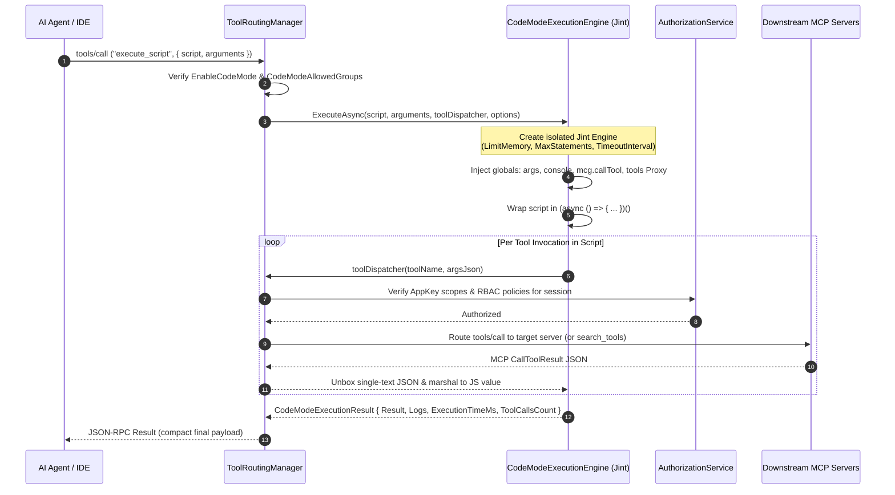
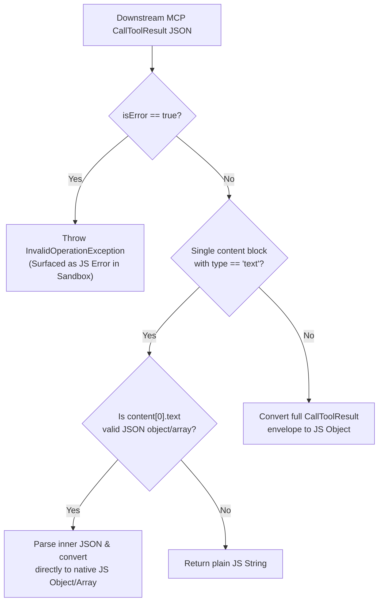

# Code Mode Sandbox Architecture

This specification details the internal design, execution lifecycle, interop bindings, and security guardrails of **MCP Code Mode (`execute_script`)**, implemented in `Core/CodeMode/CodeModeExecutionEngine.cs` and integrated into `Core/Routing/ToolRoutingManager.Execution.cs`.

---

## Architectural Overview

In standard Meta-Mode, an LLM agent discovers tools via `search_tools` and invokes them one by one via `execute_tool`. Each intermediate result travels back across the HTTP/SSE transport into the LLM context window.

**MCP Code Mode** introduces an in-process, sandboxed JavaScript execution engine powered by **Jint**. When a client invokes `execute_script`, the gateway instantiates a disposable, zero-trust Jint `Engine` with strict memory, statement, and wall-clock quotas. The script orchestrates multiple downstream MCP tool calls in memory and returns only the final computed payload.



---

## Sandbox Isolation & Security Model

`CodeModeExecutionEngine` enforces strict isolation between untrusted LLM-generated JavaScript and the host .NET runtime.

### 1. Ephemeral Engine Per Execution

The gateway never shares a Jint `Engine` instance across requests or sessions. Every `execute_script` call allocates a fresh `Jint.Engine`, executes the script to completion or termination, and disposes the engine immediately. Global variable mutations cannot leak between turns or across tenants.

### 2. Disabled CLR & Host System Access

The Jint engine is configured with default strict sandboxing (`AllowClr` is **not** enabled):
* Scripts **cannot** import .NET namespaces (`System.IO`, `System.Net`, `System.Reflection`, `System.Diagnostics`).
* Scripts have **no access** to the filesystem, environment variables, OS processes, or raw network sockets.
* The only external I/O channel available to the script is the explicitly injected `toolDispatcher` delegate.

### 3. Dual-Layer Authorization Enforcement

Code Mode never elevates caller privileges:
1. **Meta-Tool Gate (`IsCodeModeAllowedForSession`)**: Before `execute_script` appears in `tools/list` or begins execution, `ToolRoutingManager` checks `RouterSettings.EnableCodeMode` and compares the session's group claims against `RouterSettings.CodeModeAllowedGroups`.
2. **Downstream Tool Gate**: Every call to `mcg.callTool(...)` or `tools.<server>.<tool>(...)` routes back through `ToolRoutingManager.CallToolInternalAsync` using the caller's original `ClientSession` and `ClaimsPrincipal`. All 4 stages of the [Authorization Pipeline](./authorization-pipeline.md)—including AppKey scopes and fine-grained tool RBAC policies—are evaluated on every single sub-call.

---

## Resource Quotas & Guardrail Enforcement

`CodeModeOptions` binds directly to the live `RouterSettings` singleton and applies four independent resource ceilings to every execution:

| Guardrail | `CodeModeOptions` Property | Default | Enforcement Mechanism | Exception / Termination Behavior |
| :--- | :--- | :--- | :--- | :--- |
| **Memory Cap** | `MaxMemoryBytes` | `64 MB` | `options.LimitMemory(maxMemoryBytes)` inside Jint | Throws `Jint.Runtime.MemoryLimitExceededException` when JS heap allocations exceed the threshold. |
| **Statement Cap** | `MaxStatements` | `100,000` | `options.MaxStatements(maxStatements)` inside Jint | Throws `Jint.Runtime.StatementsCountOverflowException` immediately when AST statement evaluations exceed the limit (prevents `while(true){}` CPU spinning). |
| **Wall-Clock Timeout** | `ExecutionTimeout` | `30s` | `CancellationTokenSource(timeout)` + `options.TimeoutInterval(timeout)` + `options.CancellationToken(cts.Token)` | Cancels both synchronous JS loops and asynchronous `Task` awaits on downstream MCP servers. Throws `TimeoutException`. |
| **Tool Fan-Out Cap** | `MaxToolCalls` | `50` | Atomic `Interlocked.Increment(ref toolCallsCount)` inside `InvokeTool` before dispatching | Throws `InvalidOperationException` (`Maximum tool calls limit (N) exceeded in a single script execution`) before the `N + 1` call leaves the sandbox. |

---

## JavaScript Interop & Proxy Mechanics

### 1. Async Wrapper & Top-Level `return`

To allow agents to write natural, top-level `await` and `return` statements without boilerplate function wrappers, `CodeModeExecutionEngine` wraps the user script inside an immediately-invoked asynchronous arrow function:

```javascript
var __mcg_result__ = (async () => {
  // <User script injected here>
})();
```

After evaluating the wrapper, the engine unwraps `__mcg_result__`:
* If the result is a JavaScript `Promise` (`JsPromise`), the engine calls ` engine.UnwrapIfPromiseAsync(rawResult, cancellationToken)` and pumps the Jint event loop (`engine.Advanced.ProcessTasks()`) until the promise settles.
* If the promise rejects, Jint raises `PromiseRejectedException`, which the engine translates into a structured error diagnostic containing the rejection message and captured console logs.

### 2. Dual Tool Dispatchers (`mcg.callTool` and `tools` Proxy)

During sandbox initialization, the engine injects a hidden host callback `__mcg_call_tool__(toolName, argsJson)` backed by `Func<string, string, Task<JsValue>>`, and wires two user-facing JavaScript APIs on top of it:

```javascript
const mcg = {
  callTool: async function(toolName, toolArgs) {
    const serialized = toolArgs !== undefined ? JSON.stringify(toolArgs) : "{}";
    return await __mcg_call_tool__(String(toolName), serialized);
  }
};

const tools = new Proxy({}, {
  get: function(_target, serverProp) {
    return new Proxy({}, {
      get: function(_serverTarget, toolProp) {
        return async function(toolArgs) {
          return await mcg.callTool(String(serverProp) + "__" + String(toolProp), toolArgs);
        };
      }
    });
  }
});
```

This two-level ES6 `Proxy` allows arbitrary `await tools.<serverId>.<toolName>(args)` expressions to resolve dynamically at runtime without pre-generating stubs for thousands of backend tools.

### 3. Automatic MCP Envelope Unboxing (`UnboxMcpResult`)

When a downstream tool call completes, `ToolRoutingManager` returns a JSON-RPC `CallToolResult` (`{ content: [...], isError: false }`). To spare the script from manually parsing nested MCP content arrays and double-encoded JSON strings on every step, `UnboxMcpResult` applies the following transformation before marshaling the result into a `JsValue`:



### 4. Bidirectional `JsonElement` ↔ `JsValue` Marshaling

To preserve type fidelity without using dynamic `JsonRpcMessageConverter` reflection:
* **Inbound (`ConvertJsonElementToJsValue`)**: Recursively maps `System.Text.Json.JsonElement` primitives, objects (`JsObject`), and arrays (`JsArray`) directly into native Jint `JsValue` instances.
* **Outbound (`ConvertJsValueToJsonNode`)**: Converts the script's final settled `JsValue` back into a `System.Text.Json.Nodes.JsonNode` via Jint's built-in `JsonSerializer` (`new Jint.Native.Json.JsonSerializer(engine).Serialize(value)`), falling back to string conversion for non-JSON primitives.

---

## Recursive Loop Prevention

While scripts are encouraged to chain `search_tools` and `execute_tool`, `ToolRoutingManager.ExecuteScriptMetaToolAsync` explicitly blocks recursive invocations of `execute_script` from inside a running script:

```csharp
if (string.Equals(innerToolName, "execute_script", StringComparison.OrdinalIgnoreCase))
{
    throw new InvalidOperationException("Recursive execute_script calls are not permitted.");
}
```

This prevents nested Jint engine allocation attacks and guarantees bounded memory consumption per request.

---

## Related Specifications

* **[MCP Code Mode User Guide](../user-guide/code-mode.md)**: Practical scripting patterns, input parameters, and Web UI configuration.
* **[Routing, Meta-Mode & Semantic Search](./routing-and-meta-mode.md)**: How `search_tools`, `execute_tool`, and `execute_script` work together.
* **[Authorization Pipeline](./authorization-pipeline.md)**: 4-stage RBAC and AppKey scope evaluation invoked on every sandboxed tool call.
