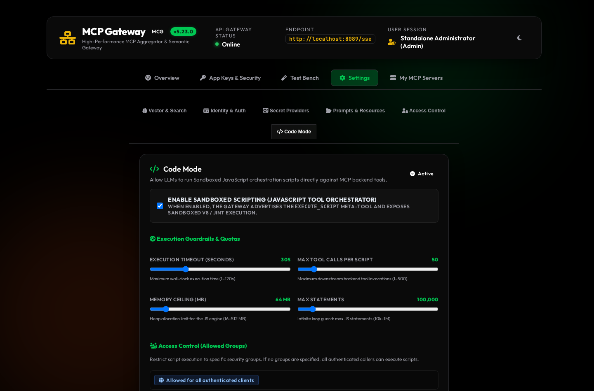

# MCP Code Mode (`execute_script`)

**MCP Code Mode** enables AI agents to orchestrate multiple MCP tool calls inside a single sandboxed JavaScript execution turn. Instead of performing five or ten sequential LLM round-trips—where every intermediate JSON payload inflates the conversation context window—the agent submits an asynchronous JavaScript snippet to the gateway's `execute_script` meta-tool.

The gateway executes the script in an isolated in-memory engine, routes intermediate tool calls through your existing authorization pipeline, filters the data locally, and returns only the final compact result to the LLM.

---

## Why Use Code Mode?

Standard MCP tool calling requires the LLM to emit a tool call, wait for the full response, parse the JSON in its context window, and emit the next tool call. Code Mode eliminates this round-trip tax for multi-step workflows.

| Capability | Standard Meta-Mode (`execute_tool`) | MCP Code Mode (`execute_script`) |
| :--- | :--- | :--- |
| **LLM Round-Trips** | 1 turn per tool call (`N` turns for `N` tools) | **1 turn** for an entire multi-step workflow |
| **Context Window Impact** | Every intermediate tool response enters the LLM prompt | Intermediate payloads stay in gateway memory; only the final `return` value enters the prompt |
| **Control Flow** | Driven by LLM token generation between turns | Native JavaScript `async`/`await`, loops, conditionals, `Array.filter`, and `Promise.all` |
| **Dynamic Discovery** | Separate `search_tools` turn before calling `execute_tool` | Inline `await mcg.callTool("search_tools", ...)` and immediate execution in one script |
| **Authorization** | Evaluated per `execute_tool` request | Evaluated per script **and** per downstream tool call inside the script |

---

## Calling `execute_script`

When Code Mode is enabled, the gateway exposes `execute_script` alongside `search_tools` and `execute_tool` on the default Meta-Mode endpoint (`/sse` or `/mcp`).

### Input Schema

The `execute_script` meta-tool accepts the following parameters:

| Parameter | Alias | Type | Required | Description |
| :--- | :--- | :--- | :--- | :--- |
| `script` | `code` | `string` | **Yes** | Asynchronous JavaScript body to execute. The gateway wraps your code in an `async` function automatically, so top-level `await` and `return` statements work directly. |
| `arguments` | `args` | `object` | No | Optional JSON object of input parameters injected into the global `args` (and `arguments`) variable inside the sandbox. |

> [!TIP]
> **Parameter Aliases for LLM Compatibility**
> Different LLM families prefer different parameter names when generating code execution calls. The gateway natively accepts both `script` and `code` for the JavaScript source, and both `arguments` and `args` for the input object.

---

## Sandbox API Reference

Scripts run inside a strict, isolated JavaScript environment with two built-in tool dispatchers, injected input variables, and structured console logging.

### 1. Explicit Dispatcher: `mcg.callTool(toolName, args)`

Use `await mcg.callTool(toolName, args)` to invoke any namespaced downstream tool or gateway meta-tool (`search_tools`, `execute_tool`).

```javascript
// Call a namespaced downstream tool
const containers = await mcg.callTool("docker__list_containers", { all: true });

// Call the gateway's own semantic search tool dynamically
const searchResult = await mcg.callTool("search_tools", {
  query: "home assistant light entities",
  limit: 3
});
```

### 2. Ergonomic Proxy Namespace: `tools.<server>.<tool>(args)`

Use the global `tools` proxy object for cleaner syntax when you already know the target server ID and tool name. Property access on `tools.<serverId>.<toolName>(args)` automatically maps to `mcg.callTool("<serverId>__<toolName>", args)`.

```javascript
// Equivalent to: await mcg.callTool("docker__list_containers", { all: true })
const containers = await tools.docker.list_containers({ all: true });

// Equivalent to: await mcg.callTool("github__list_issues", { repo: "spelech/model-context-gateway" })
const issues = await tools.github.list_issues({ repo: "spelech/model-context-gateway" });
```

### 3. Automatic JSON Unboxing

Standard MCP servers return tool results wrapped in a content envelope (`{ content: [{ type: "text", text: "{\"id\": 123}" }] }`).

Inside Code Mode, the gateway **automatically unboxes** single-text JSON payloads before returning them to your JavaScript variable:
* If a downstream tool returns a valid JSON object or array inside `content[0].text`, `await mcg.callTool(...)` resolves directly to that parsed JavaScript object or array.
* If the downstream tool returns plain text or multiple content blocks, the dispatcher returns the plain string or raw MCP result structure.
* If the downstream tool returns an MCP error (`isError: true`), the dispatcher throws a JavaScript `Error` containing the upstream error message. You can catch this error with standard `try / catch` blocks.

### 4. Injected Input Variables: `args` and `arguments`

Pass structured data into your script using the `arguments` (or `args`) parameter of `execute_script`. Read those values inside JavaScript via `args.<key>`:

```javascript
const targetNamespace = args.namespace || "production";
const pods = await tools.kubernetes.list_pods({ namespace: targetNamespace });
return pods.filter(p => p.status !== "Running");
```

### 5. Resource, Prompt & Server Discovery APIs (`mcg.*`)

In addition to calling tools, Code Mode scripts can discover and read MCP resources, prompts, and active servers directly inside the sandbox:

```javascript
// List all active authorized servers
const servers = await mcg.listServers();

// Search or list downstream resources
const matches = await mcg.searchResources("nginx");
const dockerResources = await mcg.listResources("docker");

// Read a resource (automatically unboxes single-text JSON payloads)
const containerState = await mcg.readResource(matches[0].uri);

// List and retrieve MCP prompts
const prompts = await mcg.listPrompts("docker");
const compiledPrompt = await mcg.getPrompt("docker__inspect_container", { id: "nginx" });
```

### 6. TypeScript SDK Resources & `search_tools` Signatures

Agents can inspect strongly-typed TypeScript declarations (`.d.ts`) before writing `execute_script` workflows:

| Resource / Feature | URI / Parameter | Description |
| :--- | :--- | :--- |
| **Code Mode Guide** | `router://code-mode/guide` | Markdown reference covering sandbox globals, `tools.<server>.<tool>()` proxies, and `mcg.*` APIs. |
| **Full TypeScript SDK** | `router://code-mode/sdk.d.ts` | Ambient `.d.ts` declarations for `McgSandbox` globals and all authorized server tool interfaces. |
| **Per-Server `.d.ts`** | `router://code-mode/types/{server_name}` | Focused `.d.ts` interface declarations for a single backend server ID or alias. |
| **Resource Catalog** | `router://resources/catalog` & `router://resources/server/{server_name}` | Compacted JSON directory of downstream `mcp://` resources (preventing `resources/list` context truncation). |
| **Prompt Catalog** | `router://prompts/catalog` | JSON catalog of all authorized downstream and built-in prompts. |
| **`search_tools` TypeScript Mode** | `format: "typescript"` or `include_typescript: true` | Returns compact TypeScript call signatures (`await tools.<server>.<tool>(args: { ... }): Promise<any>;`) directly from semantic search. |
| **Code Mode Meta-Prompts** | `router__code_mode_guide`, `router__write_code_mode_script` | Built-in prompts that embed live `.d.ts` declarations for target servers. |

### 7. Diagnostic Logging: `console.log`, `console.warn`, `console.error`

Call `console.log()`, `console.warn()`, or `console.error()` to record diagnostic breadcrumbs during execution. The gateway captures up to 100 log entries per run and returns them in the `logs` array of the response envelope.

---

## Scripting Patterns & Examples

### Pattern 1: Multi-Step Filtering and Aggregation

Fetch a large dataset from a backend server, filter and aggregate the records in memory, and return only a concise summary to the LLM:

```json
{
  "name": "execute_script",
  "arguments": {
    "script": "const entities = await tools.homeassistant.get_states({}); const lightsOff = entities.filter(e => e.entity_id.startsWith('light.') && e.state === 'off'); console.log(`Found ${lightsOff.length} lights currently off`); return { totalEntities: entities.length, lightsOffCount: lightsOff.length, sampleIds: lightsOff.slice(0, 5).map(e => e.entity_id) };"
  }
}
```

### Pattern 2: Discover-Then-Execute in a Single Turn

When the agent does not know the exact tool name ahead of time, it can call `search_tools` inside the script, inspect the highest-scoring schema, and invoke the discovered tool immediately:

```javascript
const matches = await mcg.callTool("search_tools", {
  query: args.intent,
  limit: 1
});

if (!matches.tools || matches.tools.length === 0) {
  return { status: "no_matching_tool", query: args.intent };
}

const bestTool = matches.tools[0].name;
console.log(`Selected tool: ${bestTool} (score: ${matches.tools[0].relevanceScore})`);

const output = await mcg.callTool(bestTool, args.payload || {});
return { executedTool: bestTool, output };
```

### Pattern 3: Cross-Server Orchestration with Error Handling

Coordinate actions across two different MCP servers (`github` and `slack`) while handling potential upstream failures gracefully:

```javascript
const prs = await tools.github.list_pull_requests({
  owner: "spelech",
  repo: "model-context-gateway",
  state: "open"
});

const stalePrs = prs.filter(pr => pr.draft === false);
const notifications = [];

for (const pr of stalePrs.slice(0, 3)) {
  try {
    await tools.slack.post_message({
      channel: args.channelId,
      text: `Review needed: PR #${pr.number} - ${pr.title}`
    });
    notifications.push({ pr: pr.number, notified: true });
  } catch (err) {
    console.warn(`Failed to notify for PR #${pr.number}: ${err.message}`);
    notifications.push({ pr: pr.number, notified: false, error: err.message });
  }
}

return { checkedCount: prs.length, notifications };
```

---

## Response Envelope

Every successful `execute_script` call returns a structured JSON envelope inside the MCP text content block:

```json
{
  "result": {
    "totalEntities": 412,
    "lightsOffCount": 18,
    "sampleIds": [
      "light.office_ceiling",
      "light.kitchen_island",
      "light.living_room_lamp"
    ]
  },
  "logs": [
    "Found 18 lights currently off"
  ],
  "executionTimeMs": 42,
  "toolCallsCount": 1
}
```

| Field | Type | Description |
| :--- | :--- | :--- |
| `result` | `any` | The value returned by your script's `return` statement (or `null` if the script does not return a value). |
| `logs` | `string[]` | Chronological list of messages emitted via `console.log`, `console.warn` (`[WARN]`), and `console.error` (`[ERROR]`). |
| `executionTimeMs` | `integer` | Total wall-clock duration of the script execution in milliseconds, including downstream tool I/O. |
| `toolCallsCount` | `integer` | Total number of `mcg.callTool` / `tools.<server>.<tool>` invocations executed during the script. |

If the script throws an unhandled exception or violates a resource guardrail, the gateway returns an MCP error (`isError: true`) containing the error message, stack details, and any `logs` captured prior to termination.

---

## Configuring Code Mode in the Web UI

Administrators can enable, tune, or restrict Code Mode at runtime from the **Settings → Code Mode** tab in the Web UI (or via the `manage_settings` Admin MCP tool).



### Resource Limits & Guardrails

Every script executes inside a Jint JavaScript engine with strict resource constraints to protect the gateway from infinite loops, memory exhaustion, or runaway tool fan-out:

| Setting | API / DB Property | Default | Valid Range | Description |
| :--- | :--- | :--- | :--- | :--- |
| **Enable Code Mode** | `EnableCodeMode` | `true` | `true` / `false` | Advertises `execute_script` in Meta-Mode `tools/list` and permits script execution. |
| **Execution Timeout** | `CodeModeExecutionTimeoutSeconds` | `30` sec | `1` – `300` sec | Maximum wall-clock duration before the sandbox cancels the script and any in-flight tool calls. |
| **Max Tool Calls** | `CodeModeMaxToolCalls` | `50` calls | `1` – `500` calls | Maximum number of downstream tool invocations allowed within a single `execute_script` run. |
| **Max Memory Limit** | `CodeModeMaxMemoryMb` | `64` MB | `8` – `512` MB | Per-script JavaScript heap allocation cap enforced by the Jint engine. |
| **Max Statements** | `CodeModeMaxStatements` | `100,000` | `100` – `10,000,000` | Maximum JavaScript AST statements executed per run to halt tight CPU loops immediately. |
| **Allowed Groups** | `CodeModeAllowedGroups` | `""` *(All)* | Comma-separated groups | Optional RBAC group allowlist (for example, `full_admin,ai_engineers`). Leave empty to allow any authenticated user with tool access. |

### Group-Based Access Control (`CodeModeAllowedGroups`)

Code Mode enforces **two layers of authorization**:
1. **Engine Entry Gate**: If `CodeModeAllowedGroups` is configured with one or more group names, only authenticated sessions belonging to at least one listed group see `execute_script` in `tools/list` and can invoke it.
2. **Per-Tool RBAC & AppKey Scope Enforcement**: Inside the sandbox, every `mcg.callTool` or `tools.<server>.<tool>` call runs under the caller's original `ClientSession`. A script **cannot** bypass tool-level RBAC policies, server-level denials, or AppKey scope restrictions.

---

## Related Documentation

* **[Code Mode Sandbox Architecture](../architecture/code-mode.md)**: Deep dive into `CodeModeExecutionEngine`, Jint AST isolation, auto-unboxing internals, and security boundaries.
* **[System Settings Guide](./settings.md)**: Full reference for all six tabs in the System Settings dashboard.
* **[Test Bench Console & Logs](./test-bench/console-and-logs.md)**: How to test `execute_script` interactively from the browser.
