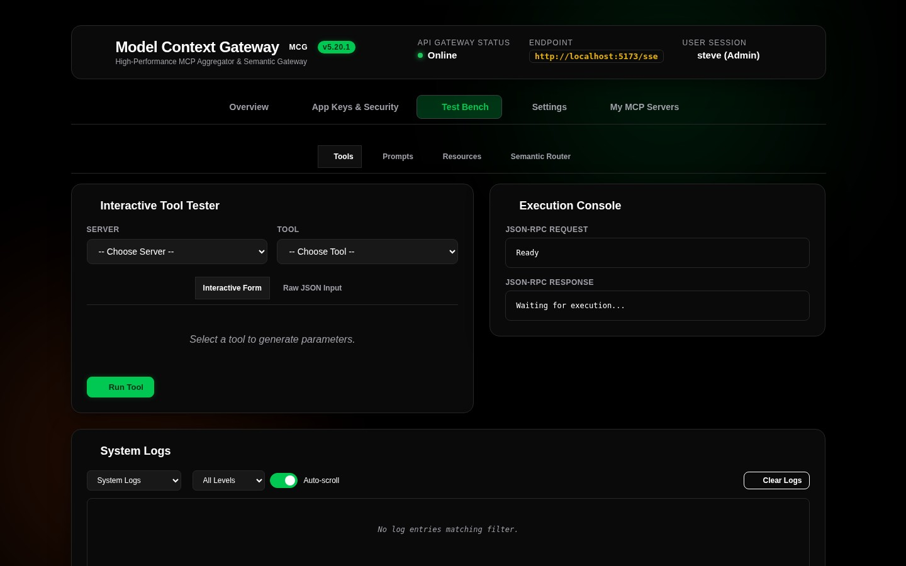

# Raw JSON-RPC Console & Live Diagnostic Logs

The **Interactive Test Bench** provides low-level debugging tools: the **Direct JSON-RPC Raw Console** for executing raw protocol payloads, and the **Live Diagnostic Logs Terminal** for real-time monitoring of gateway activity.

---

## 💻 1. Direct JSON-RPC Raw Console (`ConsoleCard`)

The Raw Console allows you to bypass the UI form builders and send exact JSON-RPC 2.0 messages directly to the gateway's routing engine:



### Useful Raw JSON-RPC Payloads for Testing

#### 1. Discover Meta-Mode Bootstrap Tools
Lists the initial bootstrap tools advertised by the gateway (`search_tools`, `execute_tool`, and `execute_script`):
```json
{
  "jsonrpc": "2.0",
  "id": 1,
  "method": "tools/list",
  "params": {}
}
```

#### 2. Perform Dynamic Semantic Tool Search
Simulates an AI assistant searching for tools matching an intent with relevance thresholding:
```json
{
  "jsonrpc": "2.0",
  "id": 2,
  "method": "tools/call",
  "params": {
    "name": "search_tools",
    "arguments": {
      "query": "find active database connections",
      "limit": 5,
      "min_score": 0.35,
      "score_dropoff_ratio": 0.60
    }
  }
}
```

#### 3. Execute Downstream Target Tool via Meta-Mode
Executes a target tool through Meta-Mode's wrapper:
```json
{
  "jsonrpc": "2.0",
  "id": 3,
  "method": "tools/call",
  "params": {
    "name": "execute_tool",
    "arguments": {
      "name": "postgres__list_connections",
      "arguments": {}
    }
  }
}
```

#### 4. Execute a Multi-Tool JavaScript Workflow via Code Mode (`execute_script`)
Runs an asynchronous JavaScript snippet inside the gateway's isolated Jint sandbox (see [MCP Code Mode](../code-mode.md)):
```json
{
  "jsonrpc": "2.0",
  "id": 4,
  "method": "tools/call",
  "params": {
    "name": "execute_script",
    "arguments": {
      "script": "const containers = await tools.docker.list_containers({ all: true }); console.log(`Total: ${containers.length}`); return containers.filter(c => c.state === 'running');",
      "arguments": {}
    }
  }
}
```

---

## 📟 2. Live Diagnostic Logs Terminal (`LogsTerminalCard`)

The Live Logs Terminal sits at the bottom of the Test Bench view. It captures and streams internal gateway logs in real time as client sessions connect and execute tools:

```text
[13:45:02.112] [INF] [McpSession:c8b4] Client authenticated as 'admin' via OIDC
[13:45:02.115] [INF] [McpSession:c8b4] Initialized Meta-Mode stream (2 tools)
[13:45:04.220] [INF] [ToolExecution] docker__restart_container invoked by admin
[13:45:04.262] [INF] [ToolExecution] docker__restart_container completed in 42ms
[13:45:10.512] [WRN] [HealthCheck] Backend 'plex' responded slowly (1250ms)
```

### Key Terminal Capabilities

* **In-Memory Ring Buffer**: Logs are streamed from an in-memory ring buffer without burdening disk I/O.
* **Automated PII Redaction**: Sensitive data—including bearer tokens, passwords, and API keys—is automatically masked as `[REDACTED]` before rendering.
* **Severity Filtering**: Filter events dynamically by `ALL`, `INFO`, `WARN`, or `ERROR` levels.
* **Auto-Scroll & Freeze**: Pause automatic scrolling to inspect active log lines without losing incoming messages.
* **Buffer Management**: Reset the display using the **Clear** button or via REST call (`DELETE /api/logs`).

---

## 💻 API & cURL Invocations for Logging

You can programmatically fetch or clear gateway logs from external scripts:

```bash
# Fetch recent diagnostic logs
curl -s http://localhost:8080/api/logs \
  -H "Authorization: Bearer <YOUR_APP_KEY>"

# Clear in-memory log buffer
curl -s -X DELETE http://localhost:8080/api/logs \
  -H "Authorization: Bearer <YOUR_APP_KEY>"
```
